# Grok Vision Drive (GVD)

Grok Vision Drive is a camera-only drive-assist toy for BeamNG.drive and BeamNG.tech. It reads camera pictures, finds the lane, plans a short path, and is built to steer the car in the game (unproven). It is for entertainment. It is not a controller for a real car, it is not a driver aid, and it is not Tesla FSD. The license is MIT.

This is an **alpha** (`VERSION` 1.7.13). It may break.

## What is proven

Every feature in this README carries exactly one status label:

- **Proven live on the dev PC**: a log or clip from the dev PC, under `GVD_data` on its data drive or in this repo, shows it working.
- **Proven live: recording only**: a live run on the dev PC recorded data with it. Nothing about GVD driving the car is proven by that run.
- **Offline smoke only**: an offline test in `scripts/` exercises it without BeamNG and without a GPU. GitHub Actions runs those tests (`.github/workflows/tests.yml`). It has not been confirmed in a live game.
- **Unproven**: nothing on file shows it working yet.

One feature is proven live, and only for recording: the command-line collector, `scripts/collect_scene_lanes.py`. The rec2 and rec3 runs recorded on the dev PC on 2026-10-19 while BeamNG's AI drove. Evidence: `GVD_data\logs\rec3_20261019.txt` and `GVD_data\scene_lanes_rec3\collect.json` on the dev PC's data drive. rec3 ran an earlier build of the collector, from branch `collector-spawn-crash-fix` (6a07d65). `cursor/scene-net-collect-e194` carries newer versions of that build's paint-coverage spawn filter (`SpawnDeck` `min_paint_cov`) and weave guard (`weave_paint_min`). Everything about GVD driving, including Alt+G, the in-game ribbon, the eight-camera drive and force feedback, is **Unproven**. Live BeamNG.tech driving by a trained model is not proven yet. Force feedback and the steering-takeover fix are not live-tested.

GVD enters **beta** when a trained model drives the car in BeamNG.

Trainer collapse fixes and event masking (`--mask-events`) are pending in PR #87 and are not merged yet.

## Quick start

Windows. You do not need an administrator account. The full agent procedure (Tech launch flags, data disk, collect, validate, train) is [AGENTS.md](AGENTS.md). Shell debugging is [DEBUGGING.md](DEBUGGING.md).

1. Run `install.bat`, then enable **Grok Vision Drive** in the BeamNG Mod Manager.
2. BeamNG.tech (eight cameras): start one game with `BeamNG.tech.exe -tcom -console -gfx vk` (Vulkan, port 25252; see [Renderer](#renderer-vulkan--gfx-vk)), then run `play_gvd_tech.bat`.
   The Tech path requires beamngpy 1.36+ (BeamNG.tech 0.39); install `requirements-beamng.txt`.
   BeamNG.drive (one window capture): run `play_gvd.bat`.
3. The **GVD VISION** window opens. Add the **GVD** app in BeamNG's UI Apps.
4. Press **Alt+G** in the game (or **Ctrl+Alt+G**, or the app's ENGAGE button) to engage. Press Alt+G again, steer, or press a pedal to take over.
5. Press `q` or Esc in GVD VISION to quit the supervisor. BeamNG stays open.

**Unplug any steering wheel before you engage**, including force feedback wheels. Turning force feedback off is not enough. A connected wheel can overwrite GVD's steering.

## UI guide

### GVD VISION window (supervisor)

`python/run_vision.py --viz` opens one OpenCV window named **GVD VISION**. The left part is the stage (the 3D view of what GVD sees). The right part is the nerd panel with tabs.

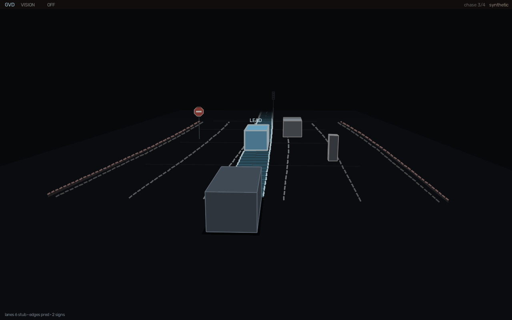

*Synthetic render from `scripts/render_readme_media.py`, not a live capture. See [docs/media/SOURCE.md](docs/media/SOURCE.md).*

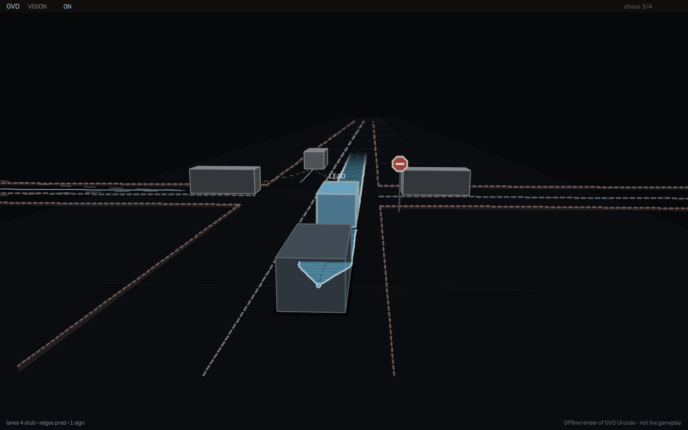

*Offline render of the GVD VISION stage from the GVD UI code. Not live gameplay.*

#### Stage elements

| Element | What it shows | Default | Status |
| --- | --- | --- | --- |
| Glance word | `OFF` / `ON` / `HOLD` / `DRIVE` / `MISMATCH`. HOLD covers preview, veto, AEB and a stale heartbeat. DRIVE needs a live apply. The in-game app and strip use the same word. | shown | Offline smoke only |
| Ice-blue ego ribbon | The planned path. It starts as a point at the car center, opens to the car width by the nose, then follows the path and stops where the path ends. | on (VIZ `corridor ribbon`) | Offline smoke only |
| Lane overlays | Seen and predicted lane lines, yellow and white. A line stops where the lane cannot be seen or predicted. Merges, exits and through lanes are drawn by role. | on (VIZ `lane paint`) | Offline smoke only |
| Curbs | Warm grey-red line 0.4 m outside the outermost real line. Predicted, not detected. | on with lanes | Offline smoke only |
| Agent boxes | Empty solid boxes for tracked cars. `LEAD` on the closest in-path vehicle, `BRAKE` when it is a hazard. | on (VIZ `track boxes`) | Offline smoke only |
| Stop bar, sign and light glyphs | Stop line and sign/light marks from perception. | on (VIZ `signs / lights`) | Offline smoke only |
| Forecast lines | Thin predicted paths for other agents. | on (VIZ `forecast fans`) | Offline smoke only |
| `cam_main` PIP | Small main-camera picture, top left, with a center cross. | on (VIZ `cam_main PIP`) | Offline smoke only |
| View mode | Chase 3/4 bird view just behind the car, or a top-down BEV. Key `T` switches. | chase | Offline smoke only |

GVD has no map widget in the supervisor. The "map" is the stage view above. The LIVE tab prints a `nav` GPS line on Tech; it is a hint only and does not route.

#### Nerd panel tabs

Tabs run in this order: **LIVE, DRIVE, VIZ, MODEL, CAMS, AUTO, KEYS**. Click a tab, or use the keys below. `[` and `]` (or Tab) cycle.

| Tab | Key | What it holds | Status |
| --- | --- | --- | --- |
| LIVE | (default) | Text readout: policy, engage, disengage reason, loop/camera Hz, infer/grab/viz ms, heartbeat ms, VRAM, camera health, lane confidence, ego speed and pedals, planner, TTC and AEB, path confidence, actuator, clip trigger. Recording buttons at the bottom. | Offline smoke only |
| DRIVE | `D` | Live gates, actuator channels, planner and AEB knobs, plus a pedal graph. | Offline smoke only |
| VIZ | `G` | Overlay layer toggles. | Offline smoke only |
| MODEL | `M` | Detector and E2E model pickers from `models/`. | Offline smoke only |
| CAMS | `A` | 3x3 camera wall with an empty center. A missing camera stays a labelled empty slot. The grid blit drops under 8 Hz. | Offline smoke only |
| AUTO | `U` | Automatic Mode (see below). | Offline smoke only |
| KEYS | `?` | Key help. | Offline smoke only |

In DRIVE, VIZ and MODEL: `j`/`k` (or Up/Down) select a row, `h`/`l` (or Left/Right) nudge it, Enter or Space toggles. Each row also has clickable `-` and `+` buttons.

**DRIVE tab rows** (all reset each supervisor start):

| Row | Does | Default | Range | Status |
| --- | --- | --- | --- | --- |
| drive on preview path | Allow actuation on a preview path | off | | Offline smoke only |
| force engage | Debug: treat as engaged without Alt+G | off | | Offline smoke only |
| ignore player override | Wheel and pedals do not disengage | off | | Offline smoke only |
| veto holds, no disengage | A veto brakes but engage stays | off | | Offline smoke only |
| policy | `session` / `modular` / `e2e` / `shadow` | session | | Offline smoke only |
| steer / throttle / brake channel | Zero that channel | on | | Offline smoke only |
| steer gain | Multiply steer | 1.0 | 0 to 2.5 | Offline smoke only |
| max \|steer\| | Clamp steer | 1.0 | 0.1 to 1.0 | Offline smoke only |
| invert steer | Flip steer sign | off | | Offline smoke only |
| hold brake | Throttle 0, brake 1 | off | | Offline smoke only |
| freeze last cmd | Repeat the last command | off | | Offline smoke only |
| AEB | Automatic emergency brake | on | | Offline smoke only |
| AEB TTC s | Brake below this time to collision | 1.2 | 0.4 to 3.0 | Offline smoke only |
| CIPV / lead | Use the lead car | on | | Offline smoke only |
| speed cap m/s | Cap target speed | 18 | 2 to 30 | Offline smoke only |
| cruise override | Fixed target speed | off (8 when turned on) | 0 to 25 | Offline smoke only |
| corridor width m | Planner corridor width | 2.0 | 1.2 to 4.0 | Offline smoke only |
| veto lane_conf min | Veto below this lane confidence | 0.25 | 0 to 0.95 | Offline smoke only |
| use lane paint | Off falls back to the preview path | on | | Offline smoke only |
| use detector tracks | Off removes CIPV and AEB from YOLO | on | | Offline smoke only |

The DRIVE tab also draws a **pedal graph**: throttle against path length, and brake against planner brake. Newest sample is on the right. Status: Offline smoke only.

**VIZ tab rows:**

| Row | Default | Key | Status |
| --- | --- | --- | --- |
| dense overlay (turns the annotation rows on together) | off | | Offline smoke only |
| corridor ribbon | on | | Offline smoke only |
| lane paint | on | | Offline smoke only |
| track boxes | on | | Offline smoke only |
| signs / lights | on | | Offline smoke only |
| forecast fans | on | | Offline smoke only |
| cam_main PIP | on | | Offline smoke only |
| dense HUD | on | | Offline smoke only |
| occupancy (from tracks, not a learned grid) | off | `1` | Offline smoke only |
| detector boxes in PIP | off | `2` | Offline smoke only |
| lane polynomials | off | `3` | Offline smoke only |
| camera FOV | off | `4` | Offline smoke only |
| planner samples | off | `5` | Offline smoke only |
| track ids | off | | Offline smoke only |
| velocity ticks | off | | Offline smoke only |
| camera strip (tiny bottom row) | off | | Offline smoke only |
| review capture | off | `R` | Offline smoke only |

Key `0` hides every layer and shows the clean stage only.

**MODEL tab rows:** `detector` (default `auto`; a YOLOv8 ONNX/pt in `models/`, or synthetic/empty) and `e2e` (default `auto`; an `e2e*.onnx` in `models/`, or the numpy stub). Status: Offline smoke only.

#### LIVE tab recording buttons

| Button | Does | Default | Status |
| --- | --- | --- | --- |
| Status mark | Green when recording, red when off. Text says `recording on` or `recording off`. | off | Offline smoke only |
| Start recording | Writes one 2272x192 strip JPEG plus one `state.jsonl` line per tick. Engage does not start or stop it. | | Offline smoke only |
| Stop recording | Stops writing. Files stay. | | Offline smoke only |
| Folder line | Click to pick a folder. The choice is remembered in `Documents/GVD/gvd_strip_record.json`. | `Documents/GVD/scene_strips` | Offline smoke only |
| Free up space | Arms a delete. Nothing is deleted yet. | | Offline smoke only |
| Confirm | Deletes the training files in that folder only. | | Offline smoke only |

#### AUTO tab: Automatic Mode

Automatic Mode records while BeamNG's own AI drives. BeamNG's AI steers. Every saved tick is labelled `driver=beamng_ai`. The tab and the command line start the same collector, `scripts/collect_scene_lanes.py`. The live runs so far (rec2, rec3) were started from the command line, not from this tab, so the Automatic Mode buttons have only passed offline tests (Offline smoke only). What has run live is the command-line collector, `scripts/collect_scene_lanes.py` (Proven live: recording only, see the CLI table).

| Control | Click does | Default | Status |
| --- | --- | --- | --- |
| Start | Starts the collector process | | Offline smoke only |
| Stop | Writes a `STOP` file and ends the collector. BeamNG stays open. | | Offline smoke only |
| map | Cycles current / west_coast_usa / italy / east_coast_usa / utah / jungle_rock_island | current | Offline smoke only |
| maps | Toggles a rotation over all five maps | current | Offline smoke only |
| route | Cycles span / waypoints / random | span | Offline smoke only |
| excursion | Toggles weaves and lane changes | on | Offline smoke only |
| speed | Raises the top of the speed range by 1 m/s, up to 30 | 8-17 m/s | Offline smoke only |
| time | Toggles a 45-minute run and run until disk floor | 45 min | Offline smoke only |
| cameras | Cycles all / main,narrow,wide | all | Offline smoke only |
| traffic | Toggles AI traffic | off | Offline smoke only |
| weather | Cycles sky / clear / rain / fog | sky (unchanged) | Offline smoke only |
| time of day | Cycles sky / 0.25 / 0.5 / 0.75 day fraction | sky (unchanged) | Offline smoke only |

Readouts under the buttons: `Automatic Mode recording|stopped`, `minutes`, `frames`, `disk` (GB written), `free` (GB free on the data disk), `AI` mode and speed, `driver=beamng_ai`, and `error`. They come from `GVD_data\status\collect.json` on the data drive. The collector stops when the data disk drops under 20 GB free.

Do not run Automatic Mode while the supervisor is also attaching cameras.

#### Keys

| Key | Does | Status |
| --- | --- | --- |
| `q`, Esc | Quit the supervisor. Disconnects only; BeamNG keeps running. | Unproven |
| `V` | Show or hide the nerd panel | Unproven |
| `?` | KEYS tab on/off | Unproven |
| `D` `G` `M` `A` `U` | DRIVE, VIZ, MODEL, CAMS, AUTO tab | Offline smoke only |
| `[` `]`, Tab | Previous / next tab | Offline smoke only |
| `j` `k` `h` `l`, arrows, Enter, Space | Select, nudge, toggle a row | Offline smoke only |
| `0`-`5` | Clean stage, or toggle debug layers 1-5 | Unproven |
| `T` | Chase view / BEV | Unproven |
| `C` | Request a manual clip | Unproven |
| `R` | Review capture on/off | Offline smoke only |

Review capture (`R`) writes `Documents/GVD/review/<UTC stamp>/tick_NNNNNN.json` and one `tick_NNNNNN_<camera>.jpg` per camera. Clips go to `Documents/GVD/clips`.

### In-game GVD app

A BeamNG UI app named **GVD** (330x440, bottom left by default).

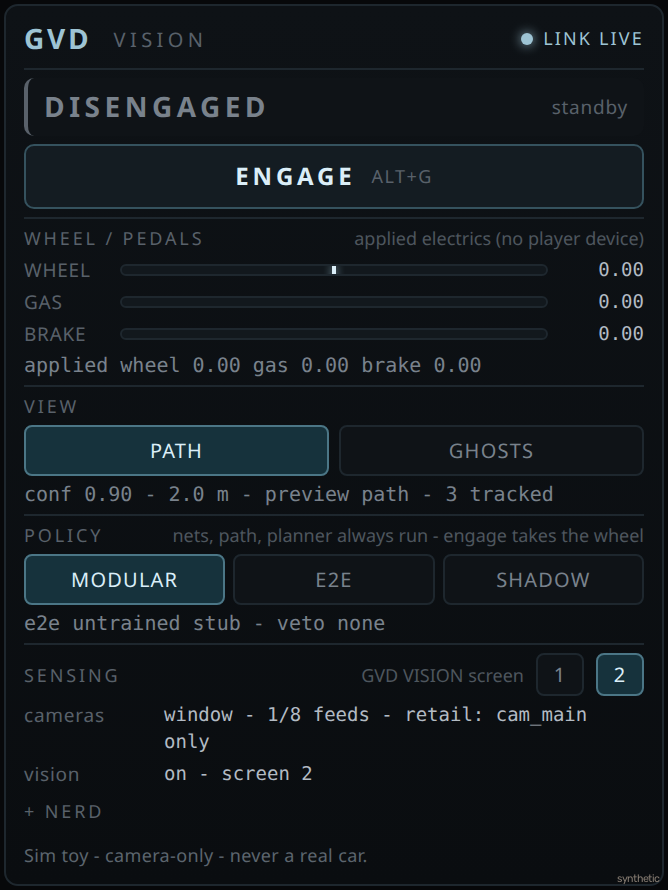
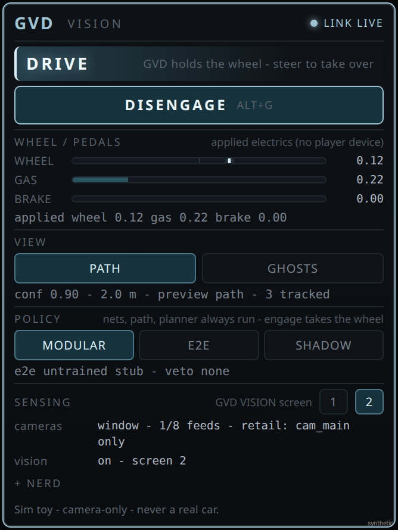

*Synthetic renders of the app's CSS, not live captures.*

| Element | Does | Default | Status |
| --- | --- | --- | --- |
| Link badge | `link live` / `link stale` / `link mismatch`. Mismatch means Python and Lua use different `Documents/GVD` folders, and actuation is refused. | | Unproven |
| State bar | Glance word and the reason (for example a dead-man note) | | Unproven |
| ENGAGE / DISENGAGE (ALT+G) | Toggles engage, same as Alt+G | disengaged | Unproven |
| WHEEL / PEDALS | Wheel, gas and brake bars, plus the applied values | | Unproven |
| VIEW: Path | World ribbon on/off | on | Unproven |
| VIEW: Ghosts | Track hulls on/off | off | Unproven |
| POLICY: modular / e2e / shadow | Session request to the supervisor | none (the supervisor's `--policy`) | Unproven |
| SENSING: 1 / 2 | Ask GVD VISION to move to monitor 1 or 2 | none (`--viz-screen auto`) | Unproven |
| + nerd | Rate, GPU, detector, actuator, clips, heartbeat, bus lines | closed | Unproven |

The world drawing in the game ("dual-viz") is an ice-blue ribbon on the pavement along the path, track hulls, and a small ice underglow under the car while engaged. Status: Unproven.

A second app, **gvd_strip**, is a one-line strip: `GVD <mode> <Hz>Hz TTC <s> N=<tracks>`, coloured by the glance word. Status: Unproven.

Engage keys come from `beamng_mod/settings/inputmaps/keyboardGvd.json`: **Alt+G**, with **Ctrl+Alt+G** as a fallback. GVD does not bind Alt+A; that is a stock BeamNG key. Status: Unproven.

### GVD TRAIN window

`python -m python.train.train_scene` opens a window named **GVD TRAIN** in the supervisor's colours. `--no-panel` skips it. `--autostart` starts without the button.

| Element | Does | Status |
| --- | --- | --- |
| recorded | Hours and minutes of recorded driving, summed from `dt_s` in `state.jsonl` | Offline smoke only |
| step | Step / total steps | Offline smoke only |
| time left | Estimated time left | Offline smoke only |
| loss | Latest loss | Offline smoke only |
| lr | Learning rate | Offline smoke only |
| steps/s | Training speed | Offline smoke only |
| VRAM or RAM | Memory in use; the CPU path is marked `not recommended` | Offline smoke only |
| device, batch | Device and batch size | Offline smoke only |
| params | Scene-net parameter count (says `approximate` before the weights are built) | Offline smoke only |
| Start | Begins a run | Offline smoke only |
| Pause | Writes a pause checkpoint beside the strip folder; the panel says `paused` | Offline smoke only |
| Loss graph | Loss for the steps of this run. Shows `loss idle` before a run. This is the only graph in the window. | Offline smoke only |

### Status files and the status command

One command prints everything that is running or ran last:

```
py -3 scripts\gvd_status.py
```

It reads `GVD_data\status` and `GVD_data\eval` on the data drive and prints collect, train, metrics, crash, live, validate, eval and free disk. Status: Offline smoke only.

| File (under `GVD_data\status\` on the data drive) | Written by |
| --- | --- |
| `collect.json` | Collector heartbeat: frames, disk, free space, AI state, driver |
| `train_heartbeat.json` | Trainer heartbeat, about every 30 s |
| `metrics.jsonl` | Trainer metrics every N steps (`--metrics-every`, default 10) |
| `train_crash.txt` | Trainer exception and the last batch |
| `live.json` | Live supervisor status |
| `validate/` | `scripts/validate_scene_lanes.py` report |
| `holdout_cells.json` | Saved spatial holdout cells |

The game bus lives in the running product's `Documents/GVD` folder (`%LOCALAPPDATA%\BeamNG\BeamNG.tech\current\Documents\GVD` for Tech): `gvd_state.json` (Python, every tick, carries the heartbeat), `gvd_engage.json` (Lua), `gvd_cmd.json` (Python command), `gvd_ego.json` (Lua echo), `gvd_ui_prefs.json` (app), `gvd_bot_engage.json` (`scripts/bot_engage.py`). The schema is [docs/gvd_state_schema.md](docs/gvd_state_schema.md).

### Command-line entry points

| Command | Key flags (default) | Status |
| --- | --- | --- |
| `py -3 python\run_vision.py` (supervisor; the `.bat` launchers add `--viz`) | `--viz` (off), `--backend auto\|beamngpy\|window\|stub` (auto), `--hz` (15), `--policy modular\|e2e\|shadow` (modular, from `config/control.yaml`), `--lane-source hough\|scene\|gt` (hough), `--scene-onnx` (`models/e2e_scene.onnx`), `--detector` (auto), `--e2e-model` (auto), `--viz-screen auto\|1\|2` (auto), `--viz-fullscreen`, `--encode auto\|qsv\|cpu\|nvenc` (auto), `--gt-log` (off), `--foxglove` (off), `--tech-probe`, `--tech-hold`, `--smoke`, `--vision-only`, `--allow-preview-drive` (off), `--allow-synthetic-detect` (off), `--force-engage` (dev only, off), `--no-engage` / `GVD_NO_ENGAGE=1` (hard engage disable, off), `--cam-age-baseline` (cam-age capture baseline: cam-age model / hold off), `--run-seconds` (0 = until stopped) | Unproven |
| `py -3 scripts\collect_scene_lanes.py` (collector) | `--minutes` (45), `--until-disk`, `--map`, `--maps`, `--map-weights`, `--segment-min` (12), `--route span\|waypoints\|random` (span), `--waypoints`, `--speed-min` (unset), `--speed-max` (unset; when set, each clamps every spawn type's range: city 8-14, highway 20-30, ramp 10-18 m/s; off the deck 8-17), `--cameras` (all), `--rates`, `--traffic [N]`, `--respawn-min` (0), `--no-impact-respawn` (impact respawn is on by default), `--time-of-day`, `--weather`, `--no-excursions`, `--weave-guard` (on; `--no-weave-guard` turns it off), `--no-jct` (junction labels on), `--ego-model` (sbr, the Hirochi eSBR electric), `--ego-config` (`vehicles/sbr/electric_800.pc`, the stock eSBR 800), `--no-vary-env`, `--smoke-s` (60), `--out`, `--data-dir`, `--reload-level`, `--check-maps`, `--list-levels`, `--dump-roads`, `--host`, `--port` | Proven live: recording only (`GVD_data\logs\rec3_20261019.txt`, `GVD_data\scene_lanes_rec3\collect.json`) |
| `py -3 -m python.train.train_scene` (trainer) | see Technical details | Offline smoke only |
| `py -3 scripts\gvd_status.py` | none | Offline smoke only |
| `py -3 scripts\bot_engage.py on\|off` | none | Offline smoke only |
| `py -3 scripts\validate_scene_lanes.py` | `--strips` (required), `--out`, `--montage` (4) | Offline smoke only |
| `py -3 scripts\eval_scene_lanes.py` | `--strips` (required), `--checkpoint`, `--check-targets`, `--out`, `--worst` (8) | Unproven |
| `py -3 scripts\relabel_painted.py <root>` | `--zip MAP=PATH`, `--out` (`gt_painted.jsonl`) | Offline smoke only |
| `py -3 scripts\live_lane_test.py` | `--seconds` (30), `--min-in-lane` (80), `--host`, `--port` | Unproven |
| `py -3 scripts\gt_report.py <log>` | `--png` | Offline smoke only |
| `py -3 scripts\build_junction_map.py <road dump>` | `--out` (`junctions/`), `--map` | Offline smoke only |
| `py -3 scripts\label_junctions.py <run> [<run> ...]` | `--junctions` (`junctions/`), `--status-dir` | Offline smoke only |
| `py -3 scripts\render_junction_overlay.py <map.json.gz>` | `--out` (required), `--navgraph`, `--roads`, `--crop`, `--px-per-m` (1), `--force` | Offline smoke only |
| `py -3 scripts\dump_navgraph.py` | `--level` (required), `--out` (required), `--host`, `--port` | Unproven |
| `py -3 scripts\run_offline_suite.py` | none | Offline smoke only |
| `install.bat`, `uninstall.bat`, `play_gvd.bat`, `play_gvd_tech.bat` | extra args pass through to the supervisor | Unproven |

## Cameras

The strip is one picture made from all eight cameras. Left to right: repeatL, pillarL, wide, main, narrow, pillarR, repeatR, rear.

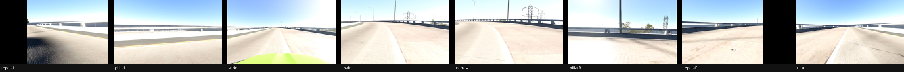

The settled game view. Soft Esc parked.

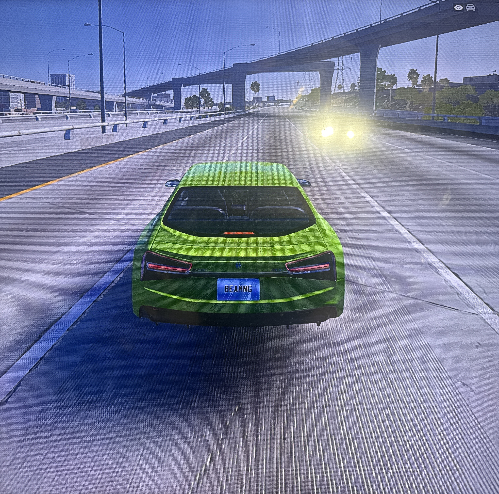

### repeatL

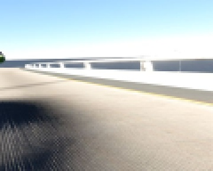

### pillarL

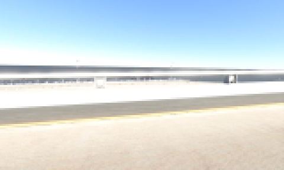

### wide

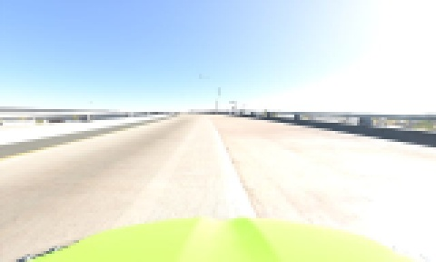

### main

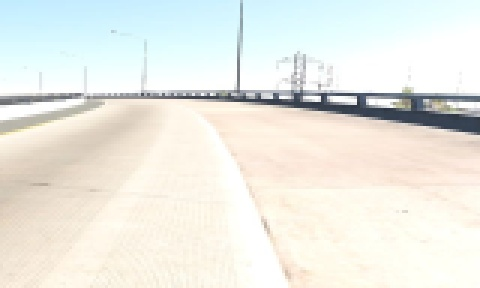

### narrow

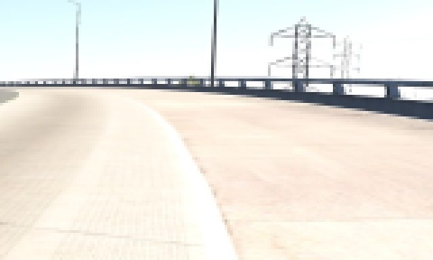

### pillarR

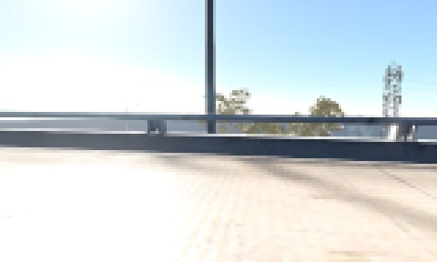

### repeatR

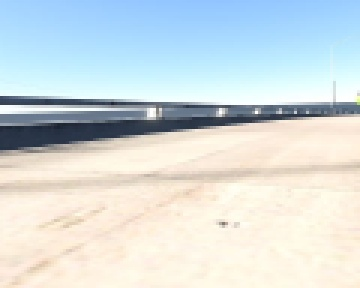

### rear

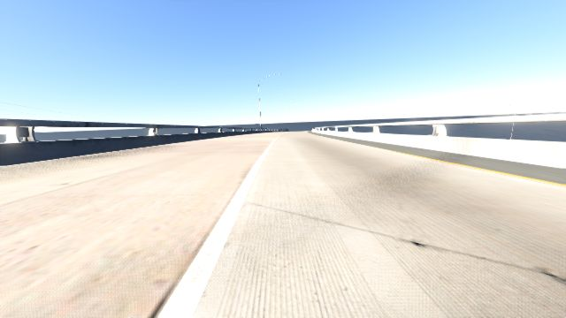

## Renderer: Vulkan (`-gfx vk`)

Start BeamNG.tech with Vulkan: `BeamNG.tech.exe -tcom -console -gfx vk`. GVD's BeamNGpy launch path and `play_gvd_tech.bat` use the same flag. **Proven live: recording only** for a 60 s collector smoke on the dev PC on 2026-10-30. Nothing about GVD driving the car is proven by it.

DX11 vs Vulkan A/B on the dev PC: each run was a 60 s collector smoke on west_coast_usa, 2 traffic cars, `--no-vary-env`, the same spawn (road 897170), eight cameras. A CPU screen recorder (libx264) ran during every run, so these Hz figures are lower than an unrecorded run.

| Metric | DX11 | Vulkan (warm shader cache) |
| --- | --- | --- |
| Collector ticks (Hz) | 8.93 | 9.20 |
| State rows (Hz) | 8.97 | 9.28 |
| `veh_s` p50 / p95 / mean (ms) | 16 / 47 / 20.5 | 15 / 31 / 11.6 |
| `poll_s` mean / p95 (ms), camera poll | 11.1 / 16 | 11.1 / 16 |
| 10 Hz camera rate (unique frames/s) | 8.96 | 9.23 |
| 2 Hz camera rate | 2.00 | 1.95 |
| 1 Hz camera rate | 1.00 | 0.98–1.00 |
| VRAM mean / max (MiB) | 4976 / 5559 | 4265 / 4389 (about 14% lower) |
| GPU utilization mean | 54% | 86% |
| Render FPS instantaneous / average | 29.4 / 30.3 | 55.4 / 62.8 |
| Window clip fps | 31.4 | 39 |
| Dark / missing / unreadable frames | 0 / 0 / 0 | 0 / 0 / 0 |
| New `beamng.log` errors vs DX11 | — | none |
| Crash or device lost | none | none |

Cold start: the first Vulkan launch with an empty shader cache took about 3.5 min (212 s) from collector start to live cameras (DX11 about 46 s, warm Vulkan about 45 s). The level load was slow enough that the collector retried the scenario, and repeatR had 1 dark frame at startup.

How each number was measured:

- Collector ticks Hz: tick count over the time span in `ticks.jsonl`.
- State rows Hz: row count over the time span in `state.jsonl`.
- `veh_s`: per-tick vehicle-sensor time from `ticks.jsonl`.
- `poll_s`: per-tick camera shared-memory poll time from `ticks.jsonl`; the timer granularity is about 15.6 ms.
- Camera rates: unique frames over the time span, per camera rate group.
- Dark / missing / unreadable: a saved PNG is dark when its mean luma is below 10; identical repeats were checked with md5 on every saved PNG.
- VRAM and GPU utilization: `nvidia-smi` sampled at 1 Hz over the driving window.
- Render FPS: BeamNG's `$fps::instantaneous` / `$fps::avg` registry values sampled at 1 Hz.
- Window clip fps: `ffprobe` average frame rate of the 15 s screen recording of the game window.
- Cold start: cameras-live time minus collector start time (1 s resolution).
- Scenario retry: `beamng.log` of the cold run loads the `gvd_collect_west_coast_usa_retry` scenario.
- Renderer: confirmed by the window title, `Engine.Render.getAdapterType()` and `beamng.log`.
- New errors: diff of normalized error and warning signatures in `beamng.log` against the DX11 run.

Caveats:

- A 2 h run on Vulkan is untested. Only the 60 s smokes above are on file.
- BeamNG's documentation warns that Vulkan in BeamNG.tech may crash with annotated cameras or multi-sensor setups. GVD runs eight cameras. The renderer is the constant `TECH_GFX` in `python/sensors/tech.py`; there is no config or env override. To fall back to DX11, either start Tech by hand with `BeamNG.tech.exe -tcom -console -gfx dx11` and attach (`play_gvd_tech.bat`, `GVD_TECH_LAUNCH=0`), or edit `TECH_GFX` to `"dx11"`.
- GPU utilization was higher on Vulkan: 54% mean on DX11 vs 86% on Vulkan. The cause was not measured.
- The first launch after a BeamNG update or a shader cache clear is slow while shaders compile. Wait for the cameras before judging Hz.

## Version

Canonical pin **1.7.13** (`VERSION`, `python/__init__.py`, BeamNG `app.json`). Untagged retail zips use `1.7.13-alpha-<sha>`. Point bumps (`1.7.x`) are fixes and small UI. A main alpha bump (`1.x.0`) is features, core, or a UI overhaul. The change history is the git log.

## Technical details

Every number in this section is a code default or a code constant on this branch. None of them is a measured result. No training score or driving score is quoted, because none has a source run, label version and holdout that holds up. The v5 training runs collapsed; do not read any v5 number as model quality.

### Architecture

| Part | What it is | Status |
| --- | --- | --- |
| Cameras | Eight BeamNG.tech cameras (`config/cameras.yaml`): main, narrow and wide on the windshield, pillarL/R aimed 78 degrees off the lane, repeatL/R on the fenders at yaw ±150, rear. `vehicle_overrides` holds per-model mounts (the eSBR's repeaters sit mirror-like, behind the front tyre and outboard of the body). Retail BeamNG.drive captures one window only. | Unproven |
| Capture | One supervisor tick reads all eight cameras from shared memory. A camera not read this tick is missing; an older frame is not reused. Companions update offscreen; a bright-blue flash frame is not stored. | Offline smoke only |
| Stitch | 2272x192 canvas: six 256x192 sectors (repeatL, pillarL, main, narrow, pillarR, repeatR), two 340x192 sectors (wide, rear), seven 8 px gaps. No pose warp. A missing camera is an empty sector. Repeater ego-body columns are cleared. | Offline smoke only |
| Supervisor | `python/run_vision.py`: capture, perception (Hough lanes by default, YOLOv8n detector), path planner, safety vetoes, actuator, viz, clips. | Unproven |
| Scene net | `python/train/scene_net.py`, trained from scratch: a per-sector conv stem (GroupNorm), a 512-wide token, a one-layer GRU (hidden 512) stepped with the real seconds since the previous strip, 15 s of memory, and a short residual skip. | Offline smoke only |
| Backbones | A backbone choice (scratch / mobilenetv3 / imagenet-resnet18) is **pending**. It is not on this branch; the stem is always trained from scratch. | Unproven |
| Heads | Linear heads on the GRU output: lanes (6 x 16 points), lane valid, curbs (2 x 16), curb valid, objects (16 x 8 with class and valid), signs (8 x 4 with class, lamp state and valid), and `lane_gt` (14 values). There is no steer head. The path planner turns the scene into the path. | Offline smoke only |
| Export | `--export` writes an FP32 ONNX graph, `models/e2e_scene.onnx`. | Offline smoke only |

**Label vector (`lane_gt`, 14 values)**, from `python/debug/lane_targets.py`:

- values 0-11: lane center, left boundary and right boundary at 5, 10, 20 and 30 m ahead, in meters, vehicle frame (x right, y forward), positive is to the right;
- value 12: heading error, radians;
- value 13: confidence, 0 to 1.

A slot with no valid geometry is NaN with mask 0. It is never scored as a centered lane.

### Painted-lane labels

Labels come from the painted line decals the camera actually sees: every `DecalRoad` whose material starts with `line` or `m_line` (`line_white`, `line_yellow`, `line_dashed_*` ...), read from the level zip. At each lookahead the nearest paint left and right of the car brackets the lane. Paint more than 3 m above or below the car (a bridge, an underpass) and paint running more than 45 degrees off the car's heading (stop lines, crosswalks) is ignored. No paint on one side means that slot is invalid, never a guessed 3.5 m lane. Status: Offline smoke only.

- `BNG_HOME` (or `BEAMNG_HOME`) must point at the BeamNG install so `content/levels/<map>.zip` can be read.
- The first read writes a paint cache, `<roads dir>/<map>_lines.json.gz`. Later reads use the cache first.
- `scripts/relabel_painted.py` relabels an existing recording offline and writes `gt_painted.jsonl` beside `state.jsonl`.

### Junction labels

Junctions come from the road dump, not from the cameras. They are used for labels and grading only and never reach steering, pedals or the AI commands.

- `scripts/build_junction_map.py` builds `junctions/<map>.json.gz` offline from a road dump (`junctions/west_coast_usa.json.gz` is committed). Road filter: drivability above 0, not hidden in the navigation graph. Gated roads (driveways, parking connectors) stay and are flagged minor, as are roads with drivability under 0.5. Nodes with 3 or more arms within 20 m (and 1.5 m in height) are one junction, typed `T`, `Y`, `4way`, `multi` or `merge`. A junction with fewer than 3 non-minor arms is `minor`.
- The collector writes `jct.jsonl` beside `state.jsonl`, one line per row, joined on `t`: `in_jct`, `jct_id`, `next_jct_m` (distance ahead along the road to the next junction circle, capped at 150 m), `jct_type`, `minor` and `src` (the map's sha256). It is create-only and never stops a recording; a map without a junction map writes no file. `--no-jct` turns it off. `state.jsonl` and `gt.jsonl` are the same bytes either way.
- `scripts/label_junctions.py` relabels finished runs with the same code, so its `jct.jsonl` matches the live one byte for byte, and also writes `jct_exit.jsonl` (the turn taken at each junction). It exits 3 without opening any `state.jsonl` while a collector is running (a fresh `running` heartbeat, or a `state.jsonl` changed under 120 s ago).
- A `jct_id` is stable only for one `src`. A new road dump or changed parameters renumber the junctions.

### Data pipeline

| Step | What happens | Status |
| --- | --- | --- |
| Collector | `scripts/collect_scene_lanes.py` attaches to a running BeamNG.tech on port 25252, never launches or closes it, and lets BeamNG's AI drive (`span` mode, lane keeping, speed limit changing every 3 minutes). Each tick writes one lossless file per camera (PNG for uint8), `state.jsonl` (timestamps, `dt_s`, camera pose and intrinsics) and `gt.jsonl` (lane targets). The first 60 s is a PNG decode smoke check. | Proven live: recording only (`GVD_data\logs\rec3_20261019.txt`, `GVD_data\scene_lanes_rec3\collect.json`) |
| Raw vs lossy | Training data comes only from the collector's lossless PNG files under `raw/`. The supervisor's Start recording JPEG strips and the review captures are for viewing, not training. The trainer and `eval_scene_lanes.py` can still read `strips/*.jpg` from a folder that has no `raw/`, so never point `--strips` at a Start recording folder. The frame cache reads `raw/` only. | Offline smoke only |
| Steering nudges | Weaves and lane changes are planned at the higher of the measured and the target speed, capped by lateral acceleration, and aborted on overspeed. Their first live recording started on 2026-10-20 and has not been reviewed yet. | Offline smoke only |
| Impact respawn | After a logged impact the car respawns from the spawn deck (`--no-impact-respawn` keeps driving). | Offline smoke only |
| Spawn deck | On west_coast_usa, `--respawn-min N` teleports to a new stratified spawn every N minutes: about 40% city, 35% highway, 25% ramps, each road used once per run (`python/collect/spawn_mix.py`). | Offline smoke only |
| Data disk | Data lives in `GVD_data` on a data drive (`GVD_DATA_DIR` overrides it). The C and D drives are refused as the data root. Runs stop under 20 GB free. The dev PC's data drive is FAT32, so no file may exceed 4 GB. | Offline smoke only |
| Frame cache | `--build-cache <dir>` decodes the chosen cameras into `.npy` chunks under 3.5 GB each, then exits. `--cache <dir>` memory-maps them. The examples below use `<cache dir>`, a folder on a fast local drive. | Offline smoke only |
| Validate | `scripts/validate_scene_lanes.py` checks a recording and writes a report and montage PNGs. | Offline smoke only |
| Time holdout | By default the last 20% of each long segment is held out, with a 4 s gap on both sides. `--holdout-blocks K` (or `GVD_HOLDOUT_BLOCKS`) spreads that over K equal time blocks. Default 1. | Offline smoke only |
| Spatial holdout | `--holdout-cells` scores a seeded set of 250 m map cells holding about 20% of rows, and drops training rows within 50 m of them. `--holdout-cells-file` (default `<status dir>/holdout_cells.json`) saves and reuses the list. `--holdout-seed` (default 0). | Offline smoke only |

Close BeamNG before training. The trainer does not start or stop it. A typical sequence (build the cache, dry-run, sanity, then the real run):

```
py -3 -m python.train.train_scene --strips <data drive>\GVD_data\scene_lanes --cams main --build-cache <cache dir>
py -3 -m python.train.train_scene --strips <data drive>\GVD_data\scene_lanes --cams main --heads lane_gt --cache <cache dir> --dry-run
py -3 -m python.train.train_scene --strips <data drive>\GVD_data\scene_lanes --cams main --heads lane_gt --cache <cache dir> --sanity
py -3 -m python.train.train_scene --strips <data drive>\GVD_data\scene_lanes --cams main --heads lane_gt --balance --cache <cache dir> --epochs 30 --export <data drive>\GVD_data\models\e2e_scene.onnx
```

### Training flags

`py -3 -m python.train.train_scene --strips <dir> ...`

| Flag | Default | Does |
| --- | --- | --- |
| `--strips` | (required in practice) | Recording folder |
| `--epochs` | 1 | Passes over the data |
| `--lr` | 1e-3 | Learning rate. It is pinned for the whole run; keep it at 1e-3. |
| `--batch` | 0 | 0 fits the largest batch in free VRAM |
| `--capability` | probed | Compute capability override. 6.1 (Pascal) stays FP32; 7.0 and newer use mixed precision |
| `--cams` | all eight | Cameras to train and export |
| `--heads` | all | Heads that get loss. `lane_gt` alone zeros the others |
| `--lane-loss` | huber | `huber`, `l1` or `mse` for `lane_gt` |
| `--augment` / `--no-augment` | on | Photometric jitter on training steps, off for validation |
| `--balance` | off | Repeat windows with curves, weaves, ramps or large steer |
| `--min-valid` | 0.3 | Drop a window when fewer rows than this have a lane center |
| `--clip` | 1.0 | Max gradient norm |
| `--scale` | 1.0 | Downscale the canvas before the cache and the net |
| `--workers` | 4 on Windows, 0 elsewhere | DataLoader workers |
| `--cache`, `--build-cache` | none | Frame cache (above) |
| `--holdout-blocks`, `--holdout-cells`, `--holdout-cells-file`, `--holdout-seed` | 1, off, status dir, 0 | Holdouts (above) |
| `--resume` / `--no-resume` | resume | Load the pause checkpoint when it exists |
| `--sanity` | off | Overfit 8 strips; exit 1 unless the lane loss falls below 0.05 |
| `--dry-run` | off | Two steps, print tensor shapes |
| `--export [path]` | off | Write the ONNX graph |
| `--metrics-every` | 10 | Steps between metrics lines |
| `--no-panel`, `--autostart` | off | Training window control |

Before the first step the trainer measures free VRAM and shrinks the batch until a step fits. It falls back to the CPU only when the card cannot hold one step, and marks that path not recommended.

### Safety

| Mechanism | What it does | Status |
| --- | --- | --- |
| Engage | Engage always starts in the game (Alt+G, Ctrl+Alt+G, the app button) or from `scripts/bot_engage.py`. Lua is the only writer of `engaged:true` in `gvd_engage.json`. Python honours it only while its timestamp is 2.5 s fresh, so a leftover `true` from a crash does not start the car. | Offline smoke only |
| Driver override | Steering against the command (on the residual, not the absolute angle), or a pedal press beyond what GVD asked for, disengages. Thresholds are in `config/control.yaml`. | Offline smoke only |
| Fresh echo (mod 1.7.13) | The mod stamps each wheel echo with `echo_seq`. The takeover check judges each fresh echo once, so repeated force-feedback kicks do not read as the driver steering. A stale echo fails safe, and a mod older than the minimum is refused. Not live-tested. | Offline smoke only |
| Heartbeat | Python stamps `gvd_state.json` every tick. Lua treats it as stale after 1.5 s: the ribbon fades and actuators stop. | Offline smoke only |
| Command dead-man | No new command for 0.35 s: Lua holds the brake. No command for 1.0 s: Lua releases the car and disengages. | Offline smoke only |
| Brake hold (Tech) | Tech drive is arcade. A hold, a stop, or AEB sets the parking brake and releases the service brake, so gear 0 plus a held brake is not reverse. | Offline smoke only |
| AEB | When a tracked lead's time to collision drops under the AEB TTC (default 1.2 s) the target speed goes to 0 and the glance word is HOLD. A warning band sits 1.3 s above that. | Offline smoke only |
| Vetoes | Low lane confidence (0.25) or path confidence (0.15) vetoes the drive. A preview path is blocked unless `--allow-preview-drive`. `--policy e2e` with no model holds the brake (`veto:e2e_stub`). | Offline smoke only |
| Launch and crash guard | Caps throttle while launching and stops on a damage jump or a stuck car (`python/control/launch_guard.py`). | Offline smoke only |
| Bus check | If Python and Lua use different `Documents/GVD` folders, the link is `MISMATCH` and actuation is refused. | Offline smoke only |
| cmd-json fallback | With a BeamNGpy vehicle (Tech) the supervisor calls `vehicle.control`. Otherwise it writes `gvd_cmd.json` and the mod's Lua applies it on the player car. `cmd_applied` is true only when the Lua ack is within 5 sequence numbers. | Offline smoke only |

### Hardware target

- CPU i9-9900K, 32 GB RAM, GPU GTX 1080 Ti (11 GB, Pascal, no tensor cores) shared with BeamNG (`config/hardware.yaml`).
- Vision inference VRAM cap: 4 GB (`max_inference_vram_gb`). Live input long side 640 px.
- Small models only: the shipped detector is YOLOv8n (`models/yolov8n.onnx`). No transformers, ViT or BEV nets.
- Clip encoding prefers Intel Quick Sync on the UHD 630, then CPU x264. NVENC is used only with `--encode nvenc`.

### Debug tooling

- `scripts/gvd_status.py`: one-screen status (above).
- `scripts/validate_scene_lanes.py`, `python/debug/dataset_check.py`: check a recording.
- `scripts/eval_scene_lanes.py`: score lane centers on the time holdout.
- `--gt-log` or `GVD_GT_LOG=1`: per-tick ground truth under `logs/gt_<stamp>.jsonl`; `scripts/gt_report.py` summarizes it.
- `--lane-source gt`: drive on road-network lanes to test the controller alone.
- Live camera frames are the raw buffers the recorder saves (no tone curve). `GVD_LIVE_TONE=1` (off by default) puts the old washed-road curve back on the live frames for the pixel lane finder; the scene net was not trained on that picture.
- `scripts/live_lane_test.py`: headless lane-keep check against a running BeamNG.tech.
- Review capture (`R`), clips (`C`), `--foxglove` live view, `--tech-probe` and `--tech-hold` preflights.
- `scripts/run_offline_suite.py`: the offline tests CI runs. Each script gets its own temp home, AppData and torch cache, so no GVD bus file leaks between tests.

### Known limitations

- **Live BeamNG.tech gates are largely unproven.** Alt+G, the in-game ribbon, the eight-camera drive, force feedback and Quick Sync have no live proof on file.
- **The car does not yet drive from a trained model.** No scene-net checkpoint has been shown to keep a lane live.
- **Unpainted roads are not handled.** Labels need DecalRoad paint. Paint baked into the terrain texture gets no labels, so those roads are invalid slots.
- **Lane keeping only.** There is no intersection handling, no turns at junctions and no routing.
- **Trained on west_coast_usa only.** Treat any model as a west_coast_usa model. The labelled data so far is mostly from that map, and the spawn deck covers only that map.
- **Vision-only toy, not a driver aid.** LiDAR, radar and IMU extras are for display and are ignored by the planner.
- **Not every collision is caught.** The collector writes `impacts.jsonl` and respawns after a logged impact, but it does not catch every collision. The supervisor infers crashes from vehicle damage jumps and stuck detection, which miss light contacts.
- Retail BeamNG.drive is one window capture, not eight cameras.
- **Live side-camera stamps are per pass, not per read.** The recorder reads all 8 cameras in about 1 ms each, so a companion's stamp lands a few ms after main's (the hold's `now`). Live reads take about 8 ms each, so a raw stamp would land 31–88 ms after `now` and trip `cam_hold`'s never-look-ahead rule. Live therefore stamps a camera read in this tick's pass at `min(read stamp, now)`. Which frame is held or black matches the recorder's for any per-camera read time. Held ages can still differ by one 1/15 s tick near a rounding boundary, because the recorder's own stamps carry its few-ms read offsets.
- **The live narrow 800→400 m hitch is off.** The recorder attaches narrow once at the attach yaml's 800 m and never reattaches. Live keeps narrow at 800 m too (`RECORDER_NARROW_HITCH = False` in `python/sensors/cameras.py`).
- **In-place reset detection is a heuristic.** beamngpy 1.36 exposes no vehicle reset event or counter, so the cam-age hold treats a reset as a change the car cannot make: body speed changing by more than 1.5 g · dt + 1 m/s, or a move further than speed · dt + 2 m, on top of the vehicle id, reconnect and 10 m jump checks. A reset that leaves speed and position nearly unchanged (a reset while stopped) is not seen; the 1.5 s hold cap bounds what carries over. A hard crash can also read as a reset (the hold is cleared, nothing else).

## Credits

GVD uses these outside projects. Each one is its authors' work.

- [BeamNG.drive](https://www.beamng.com/). Retail play captures the BeamNG.drive window.
- [BeamNG.tech](https://beamng.tech/). The eight-camera session runs in BeamNG.tech.
- [BeamNGpy](https://github.com/BeamNG/BeamNGpy). Tech sessions, cameras, and electrics use BeamNGpy.
- [NumPy](https://numpy.org/). Frames and the planner math are NumPy arrays.
- [OpenCV](https://opencv.org/). The vision window, strip JPEGs, lane fit, and training panel use OpenCV.
- [PyYAML](https://pyyaml.org/). Config files are loaded with PyYAML.
- [PyTorch](https://pytorch.org/). Scene-net training and ONNX export use PyTorch.
- [ONNX](https://onnx.ai/). The exported scene graph and the detector files are ONNX.
- [ONNX Runtime](https://onnxruntime.ai/). Play time runs those graphs with ONNX Runtime.
- [Ultralytics](https://github.com/ultralytics/ultralytics). The shipped YOLOv8n detector is an Ultralytics checkpoint, and the ultra path loads it with their library.
- [YOLOX](https://github.com/Megvii-BaseDetection/YOLOX). An optional detector path reads a Megvii YOLOX ONNX file.
- [Foxglove SDK](https://github.com/foxglove/foxglove-sdk). An optional live view publishes with the Foxglove SDK.
- [BetterCam](https://github.com/RootKit-Org/BetterCam). Windows window capture uses BetterCam.
- [mss](https://github.com/BoboTiG/python-mss). Window capture uses mss when BetterCam is unavailable.
- [pywin32](https://github.com/mhammond/pywin32). Windows matches the BeamNG window title with pywin32.
- [FFmpeg](https://ffmpeg.org/). Review clips are encoded with FFmpeg when it is on PATH.

## License

GVD's license is MIT (`LICENSE`). Detector weight notices are in `models/NOTICE.txt`.
